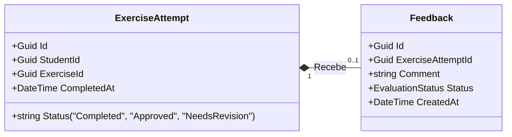

# Modelo de Dados: Sistema de Avaliação e Feedback

Este documento descreve a estrutura de dados, tipos de dados do .NET 8 e as regras de validação para as novas entidades adicionadas para suportar o fluxo de Avaliação e Feedback, estendendo os modelos existentes em [ferramentas-ia/spec-kit/codigo-exemplo/projeto-base/src/MonitoriaBase/Models/ExerciseAttempt.cs](ferramentas-ia/spec-kit/codigo-exemplo/projeto-base/src/MonitoriaBase/Models/ExerciseAttempt.cs).

---

## 1. Nova Enumerabilidade: EvaluationStatus

Representa o status final da avaliação emitida pelo monitor sobre a tentativa.

```csharp
namespace MonitoriaBase.Models;

public enum EvaluationStatus
{
    Approved,
    NeedsRevision
}
```

- **Approved**: Indica que a solução está correta e atende a todos os critérios pedagógicos/técnicos.
- **NeedsRevision**: Indica que a solução possui pontos de atenção ou erros conceituais e precisa ser corrigida e ressubmetida pelo estudante.

---

## 2. Nova Entidade: Feedback

Representa o feedback textual e a conceituação estruturada fornecida pelo monitor sobre uma tentativa de exercício do aluno.

```csharp
namespace MonitoriaBase.Models;

public class Feedback
{
    public Guid Id { get; init; }
    public Guid ExerciseAttemptId { get; init; }
    public string Comment { get; init; }
    public EvaluationStatus Status { get; init; }
    public DateTime CreatedAt { get; init; }

    public Feedback(Guid exerciseAttemptId, string comment, EvaluationStatus status)
    {
        if (exerciseAttemptId == Guid.Empty)
            throw new ArgumentException("ExerciseAttemptId cannot be empty.", nameof(exerciseAttemptId));

        if (string.IsNullOrWhiteSpace(comment))
            throw new ArgumentException("Comment cannot be null or empty.", nameof(comment));

        if (comment.Length < 10 || comment.Length > 5000)
            throw new ArgumentException("Comment must be between 10 and 5000 characters.", nameof(comment));

        Id = Guid.NewGuid();
        ExerciseAttemptId = exerciseAttemptId;
        Comment = comment;
        Status = status;
        CreatedAt = DateTime.UtcNow;
    }
}
```

### Atributos:
- **Id**: Identificador único global do feedback (`Guid`).
- **ExerciseAttemptId**: Referência à tentativa correspondente (`Guid`). Força a integridade do relacionamento 1-para-1.
- **Comment**: Comentário técnico livre do monitor (`string`).
- **Status**: Status da avaliação (`EvaluationStatus`).
- **CreatedAt**: Data e hora exatas da submissão do feedback (`DateTime`). Estabelecido automaticamente no construtor.

---

## 3. Relacionamento e Integridade Teórica

A relação se estabelece a partir da tentativa do aluno:



- **Múltiplas Tentativas**: Um Aluno pode submeter mais de uma tentativa (`ExerciseAttempt`) para o mesmo exercício se a primeira precisar de revisão. Cada tentativa terá seu próprio registro em `ExerciseAttempt` e poderá receber um registro específico correspondente de `Feedback`.
- **Efeito Colateral de Consistência**: Ao criar e persistir um `Feedback`, o sistema deve atualizar imediatamente a string `Status` do `ExerciseAttempt` referenciado de `"Completed"` para a representação textual do status avaliado (`"Approved"` ou `"NeedsRevision"`).

---

## 4. Regras de Validação e Consistência (Verificação)

Antes da criação do feedback, as seguintes condições devem ser garantidas pela lógica de negócios:

1. **Existência da Tentativa**: O `ExerciseAttemptId` fornecido deve corresponder a uma tentativa real e existente no sistema.
2. **Status da Tentativa**: A tentativa referenciada deve estar no status `"Completed"`. Não é permitido submeter novos feedbacks para tentativas que já foram avaliadas (`"Approved"` ou `"NeedsRevision"`).
3. **Imutabilidade**: O feedback uma vez armazenado não pode sob nenhuma circunstância sofrer modificações em seus campos `Comment` ou `Status`.
4. **Regras de Tamanho do Comentário**:
   - Mínimo de 10 caracteres (impede feedbacks vagos como "Legal", "OK", "Correto").
   - Máximo de 5000 caracteres (restrição de segurança de estouro de memória).
